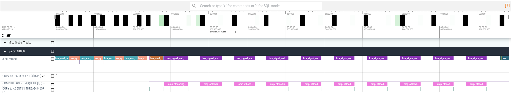
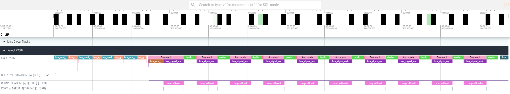
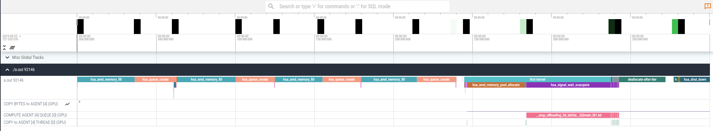
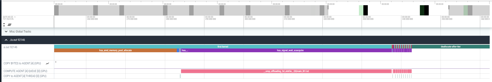
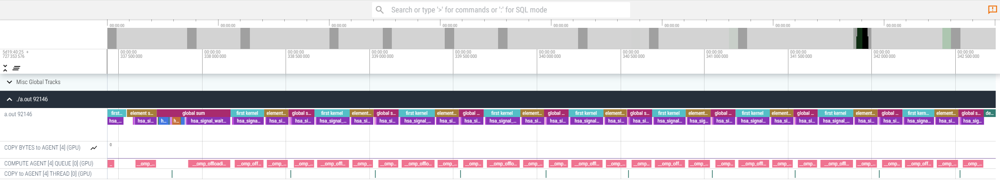
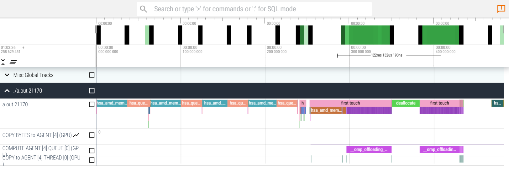

# Exercise rocprofv3 with roctx-markers: Dynamic memory allocations and memory pool on MI300A
This exercise highlights the importance of the reduction of dynamic memory allocations on MI300A with unified memory and shows a way to discover such an issue with rocprofv3 and how to use roctx markers in Fortran. So this exercise teaches you about a common performance problem on MI300A as well as how to use rocprofv3 with roctx markers.

## Environment

### On AAC7
allocate a shared node with 1 APU:
```
salloc -N 1 --mem=20GB --gpus=1 -p 192C4G1H_MI300A_RHEL9_A1_CPX
```

Set up ROCm 10.1.0 and the LLVM-based `amdflang` compiler:
```
module load rocm-new/10.1.0  # on AAC7
export FC=amdflang
```

### On AAC6
allocate a shared node with 1 APU:
```
salloc -N 1 --gpus=1 -p PPAC_MI300A_CPX
```

Use the ROCm module instead:
```
module load rocm/10.1.0      # on AAC6
export FC=amdflang
```
##  Check Environment
Check with ```echo $FC``` and ```$FC --version``` that you are using ```amdflang```.

Enable unified memory on MI300A:
```
export HSA_XNACK=1
```

## version 1: Problem
The first version is an OpenMP offload example with three kernels in an iterative loop as an example of a "dwarf" of an application with an iterative solution or multiple time steps.
```
cd version1_problem
```
Compile the code with:
```
${FC} -fopenmp --offload-arch=gfx942 -o test_mempool test_mempool.f90
```
and run the example with rocprofv3
```
rocprofv3 --sys-trace --output-format pftrace --output-file timeline_v1 -- ./test_mempool
```

Download the trace timeline_v1_results.pftrace file.
Copy the generated timeline_v1_results.pftrace file to your local machine
```
scp -i <path/to/ssh/key> <username>@aac7.amd.com:~/<path/to/pftrace/file> .
```
and use the browser (Chrome recommended) to open the web page [https://ui.perfetto.dev/](https://ui.perfetto.dev/).

Click `Open trace file` and select the timeline_v1_results.pftrace file. Below, you can see an example of how the trace file would be visualized with `Perfetto`: [https://ui.perfetto.dev/](https://ui.perfetto.dev/).

<p></p>
Note that different versions of rocprofv3 may have more or less information showing depending on the version. ROCm 10.1.0, for example, also shows allocated memory on the device.
With zooming in and out (asdw keys or press Ctrl+scroll with mouse) one can see that the first kernel in each iteration is extremely long compared to all other kernels. Note that on the coarsest zoom level you may not even be able to see the other kernels, zoom in on the end of a kernel to make the short ones visible.
Additionally, there are large gaps in between despite all computations are offloaded to the GPU. 

- Why is the computation taking that long in the first kernel of each iteration? 
- Why are there gaps? Didn't we port everything to the GPU?
  
One possibility to explore this is manual instrumentation with roctx markers. Using rocprof-sys (formerly omnitrace) is also an option, but we will use rocprofv3 here to demonstrate the usage of roctx markers for manual instrumentation.

## version 2: Instrument manually with roctx markers to understand the problem
This version is instrumented with roctx markers to better understand what is going on in the observed "gaps".
Either use version 1 and try to instrument the code yourself with roctx markers or have a look at version2 to see how you can implement roctx markers in Fortran.
```
cd ../version2_roctxMarkers
```
Have a look at the code with
```
vi test_mempool.f90
```
or use ```vimdiff <file1> <file2>``` to see the difference compared to version one.

Compile with roctx markers:
```
${FC} -fopenmp --offload-arch=gfx942 -L${ROCM_PATH}/lib -lrocprofiler-sdk-roctx -o test_mempool test_mempool.f90
```
Note the added linking option for rocprofiler-sdk-roctx. In a true app you would add this in a Makefile, but for education purposes it is shown here what needs to be in the command.
Run rocprof tracing again. Don't forget to include the `marker-trace` option now:
```
rocprofv3 --sys-trace --marker-trace --output-format pftrace --output-file timeline_v2 -- ./test_mempool
```
The total execution time is roughly equal to the previous example, so the overhead of the roctx markers is lower than the runtime differences observed for different runs in this case.

Explore the trace again in perfetto after the download of the trace. 
Now you can see the annotated regions in the trace.
<p></p>

With zooming in and out (asdw keys or press ctrl+scroll with mouse) one can see that the first kernel marked with the roctx markers as ```first touch``` in each iteration is extremely long compared to all other kernels and deallocations marked also with a roctx marker take a significant amount of time. The following kernels are almost insignificant compared to the first one, but is this really unavoidable that this first kernel takes so much time? Comparing the amount of arrays which need to be loaded, the first and second kernel should not be too different, at least in the same order of magnitude, but why isn't this the case? The allocation does not happen at ```allocate``` but when the data is touched the first time. This initial process -the recovery from a GPU page fault- takes a lot of time on MI300A when using unified shared memory.

## version 3: Solution no dynamic allocation and deallocation
In this version the allocations are moved outside the iteration loop. If you compile and run again with rocprofv3 you get a trace which shows only a long time for the "first_touch" region in the first iteration. The same region in following iterations shrinks as it is no true first touch of the data anymore. 
```
cd ../version3_solution1
```
Compiler:
```
${FC} -fopenmp --offload-arch=gfx942 -L${ROCM_PATH}/lib -lrocprofiler-sdk-roctx -o test_mempool test_mempool.f90
```
Profile:
```
rocprofv3 --sys-trace --marker-trace --output-format pftrace --output-file timeline_v3 -- ./test_mempool
```
First thing you will notice is that the runtime is siginificantly lower!

Explore the trace again in perfetto after download.

<p></p>
The first iteration's first kernel is still costly:
<p></p>
but the subsequent ones are almost vanishing compared that first one, we need to zoom in to find them:
<p></p>
This is the case, because allocations (especially with system allocators, i.e. 'allocate') with unified memory are costly on MI300A. We see the penalty in the first kernel, as the memory is allocated at first touch. Subsequent iterations work on already allocated memory and we do not see that penalty. The deallocation is also only done once at the very end and we do not pay the high price of it in each iteration.
The gain improves the more iterations we do not have to do dynamic allocations and deallocations, therefore in typical simulation applications where multiple iterations or time steps are executed, it is a very important performance optimization.
We can learn from this that dynamic allocations and deallocations on MI300A should be avoided. 
But what if that is very hard to do in a true app which uses different temporary arrays in each subroutine?

## version 4: Solution memory pool
A possible solution is to use a memory pool. An example pool you can use in C/C++ and Fortran is the library Umpire (developed by LLNL).
```
cd  ../version4_solution2
```
For the trainings we usually provide a module for Umpire:
```
module load umpire/<version-matching-loaded-rocm> #check with module avail umpire what you need to load in case there are multiple versions (e.g. on aac7) 
```
This module sets the ```UMPIRE_PATH``` for you.

Have a look how the memory pool is set up in the code by looking at version 4.
Compile and run with roctx markers and Umpire:
```
${FC} -fopenmp --offload-arch=gfx942 -I${UMPIRE_PATH}/include/umpire -L${UMPIRE_PATH}/lib64 -L${UMPIRE_PATH}/lib -lumpire -lcamp -lfmt -L${ROCM_PATH}/lib -lrocprofiler-sdk-roctx -lamdhip64  -lrt  -lstdc++ -o test_mempool test_mempool.f90
```
As you can see, the compilation line becomes a little long and in a true app you would set all this in Makefile / through the build system.

```
rocprofv3 --sys-trace --marker-trace --output-format pftrace --output-file timeline_v4 -- ./test_mempool
```
now only in the first two iterations -when the memory pool still 'warms up'- you see a longer "first_touch" kernel. In the following the kernel times are in the order of microseconds again:
<p></p>

The total execution time is roughly:  0.232587 s (ROCm 10.1.0, Oct 2026), so the speed up is a little less than moving the allocation outside, but also for the memory pool we only pay the price in the first 2 iterations until the library figured out the size of the pool. This is usually negligible if hundreds to thousands of iterations / time steps are run in production applications which do more iterations than this training example. If you implement the memory pool in an application you can investigate the impact of the defaults of the pool setup on your performance. Also consider to use different pools for large and small allocations.

Conclusion: The usage of memory pools is recommended if you have frequent allocations and deallocations in your application and cannot move the allocations outside the loop!

## version 5: Further remarks
```
cd  ../version5_wrapMarkerInifdefs
```
Recommendation: wrap roctx markers in ifdefs, to compile:
```
${FC} -cpp -fopenmp --offload-arch=gfx942 -DUSE_ROCTX -I${UMPIRE_PATH}/include/umpire -L${UMPIRE_PATH}/lib64 -L${UMPIRE_PATH}/lib -lumpire -lcamp -lfmt -L${ROCM_PATH}/lib -lrocprofiler-sdk-roctx -lamdhip64  -lrt  -lstdc++ -o test_mempool test_mempool.f90
```
compiling with -cpp you can use preprocessor ifdefs. This way you can run without roctx markers in production, but can easily reactivate as needed for tracing.
<hr>
Further best practices / recommendations: if you use unified memory on MI300A (with ```export HSA_XNACK=1```), which is highly recommended to avoid unnecessary memory copies, make sure you know how to set the affinity of CPU cores and GPU correctly such that the memory is allocated and initialized where it is used and not on another APU on the same node! On MI300A an MPI process pinned to CPU cores 0 to 23 should offload to GPU 0, an MPI process on cores 24 to 47 to GPU 1 etc. In SPX mode (see rocm-smi output, this mode is default on most systems) it is usually best to use 1 MPI process per APU to offload and use e.g. OpenMP on the CPU cores to parallelize across CPU cores. In TPX or CPX mode one APU shows 3 or 6 (smaller) GPUs and one MPI process to drive the offload to each of those may be optimal. This is especially a good option for codes where part of the code (still) runs on the CPU. How to set this up properly may strongly depend on your HPC center's configuration, so please consult the respective documentation how to run in your environment.
In this example you will e.g. already see better performance in the above exercise with ```export ROCR_VISIBLE_DEVICES=0``` as all arrays are only touched by the GPU.
If you use GPU aware MPI with Cray MPICH you need GPU allocated buffers i.e. ```omp_target_alloc``` or ```hipmalloc``` allocated memory. You can also achieve GPU allocations through using the Device instead of Host allocator pool in Umpire.
</hr>

For a complementary profiling workflow with rocprofiler systems, see the [rocprofiler-systems memory pool exercise](../../../../rocprofiler-systems/MemoryPool). It uses the same Fortran example and can show the allocation/page-fault issue faster and more easily when profiling a large application. It also shows futher mitigation strategies for the underlying first touch issue.
